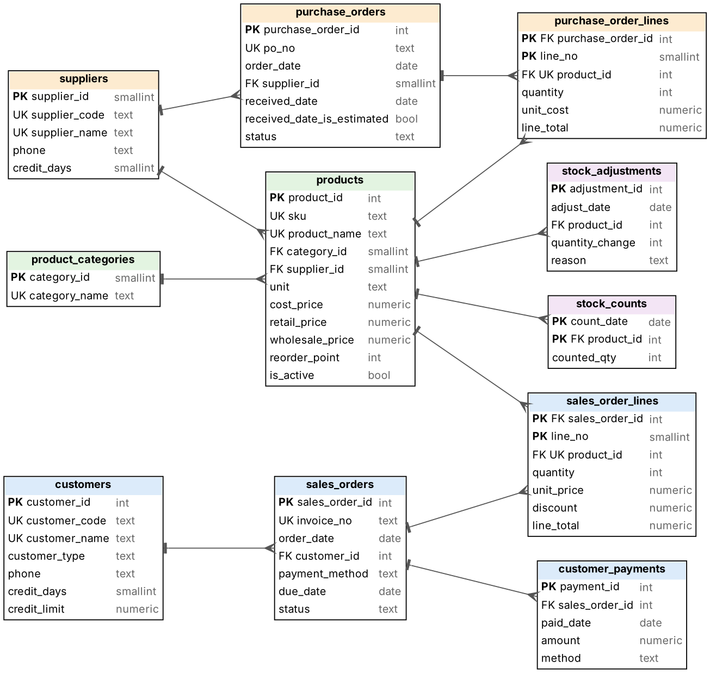

# Retail/Wholesale Shop Database (PostgreSQL)

**Portfolio project by Jalentiq Analytics · demonstrates Database Design & Setup · simulated data**

> All data is simulated. This project shows how messy Excel records can become one reliable, checkable database; it is not a real shop's data.

## The problem

A fictional Thai shop sells to walk-in customers (retail) and to contractors and small shops on credit (wholesale). Twelve months of records (Nov 2025 – Oct 2026: 9,013 invoices, 16,730 sale lines, 250 products, 150 customers, 25 suppliers, 1,197 purchase orders) sit in **six Excel files** with mixed date formats (Western and Buddhist-era years, as text and as dates), product names typed differently each time, duplicate rows, subtotal rows inside the data, numbers stored as text, and unidentifiable items.

## What was built

- **ERD and schema:** 11 core tables plus an exceptions log, with 64 rules (primary and foreign keys, uniqueness, CHECK constraints) so bad data is rejected.
- **Import script:** reads only the original Excel files, cleans them by documented rules, loads PostgreSQL in about 4 seconds, and logs anything it cannot safely fix instead of guessing (124 items for the owner to confirm).
- **12 data-quality checks** (`03_validation_checks.sql`) and **10 example business queries** (`04_example_queries.sql`): sales and margin by month, reorder list, receivables by age, dead stock, price below cost, stock count differences, supplier lead time.
- **Thai documents:** data dictionary, handover guide (install, back up, add a sale, run checks) and a 4-page case study.



## Results of the test run

- Invoices, sale lines, payments and purchase orders loaded: 9,013 / 16,730 / 800 / 1,197.
- Sales, payment and purchase totals match the clean source data to 0.00 baht.
- 0 of 16,674 matched sale lines assigned to the wrong product; 56 lines whose product could not be identified keep their money under a "to be checked" product and are listed for the owner.
- 6 bad inserts (negative quantity, credit invoice with no due date, wholesale price above retail, and others) were rejected by the database.
- The full backup restores into a fresh database, and all 10 example queries run.

## Run it (PostgreSQL 16)

See `database/RUN_ORDER.txt`. Quick start:

```bash
psql -U postgres -c "CREATE DATABASE shopdb"
psql -U postgres -d shopdb -f database/shop_database_FULL_DUMP.sql
psql -U postgres -d shopdb -f database/04_example_queries.sql
```

## Limitations

- **Not a blind test:** the same person created the messy files and the checks. "Matches to 0.00 baht" means matches the simulated source data; a real shop will have problems nobody expected and needs a confirmation round with the owner.
- Gross margin uses the **current standard cost**; there is no cost history.
- Invoice and PO numbers are entered manually; ongoing use needs a data-entry form that issues them.
- No POS integration, no entry screens and **no Power BI dashboard** is included (the views are ready to connect one).
- Tested on PostgreSQL 16 only.

## Contact

Use the GitHub profile: [JalentiqAnalytics](https://github.com/JalentiqAnalytics).

---

# ฐานข้อมูลร้านค้าปลีก-ค้าส่ง (PostgreSQL)

**ผลงานของ Jalentiq Analytics · ตัวอย่างบริการ Database Design & Setup · ข้อมูลจำลอง**

ร้านสมมติมีข้อมูล 12 เดือนกระจายใน Excel 6 ไฟล์ จดไม่เหมือนกัน (วันที่ปนกัน ชื่อสินค้าพิมพ์ไม่ตรง แถวซ้ำ ตัวเลขเป็นข้อความ) โปรเจกต์นี้ออกแบบฐานข้อมูล PostgreSQL นำข้อมูลเข้าด้วยสคริปต์ ตรวจคุณภาพ 12 ข้อ และเขียนเอกสารภาษาไทย (พจนานุกรมข้อมูล คู่มือส่งมอบ กรณีศึกษา) รายการที่ระบบแก้เองไม่ได้จะถูกบันทึกให้เจ้าของร้านยืนยัน ไม่เดาตัวเลข

**ข้อควรรู้:** ผู้ทำสร้างทั้งไฟล์ที่มีปัญหาและตัวตรวจ จึงไม่ใช่การทดสอบแบบปิดตา ผลที่ตรงทุกสตางค์หมายถึงตรงกับข้อมูลต้นแบบสมมติ ไม่รวมไฟล์แดชบอร์ด Power BI และทดสอบบน PostgreSQL 16 เท่านั้น
